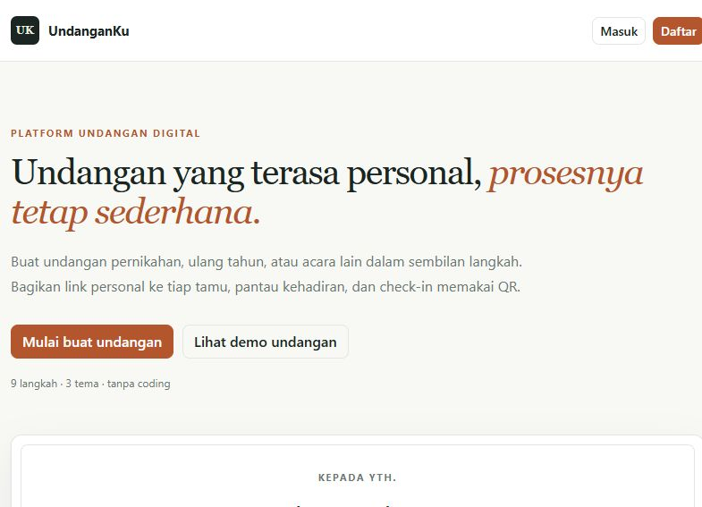
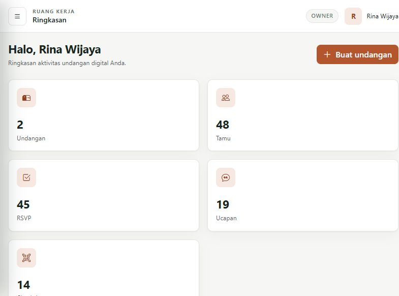
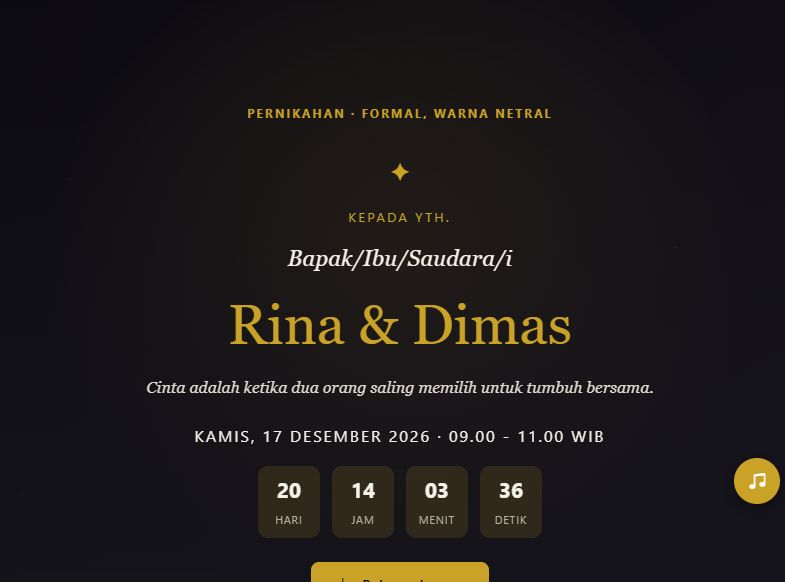
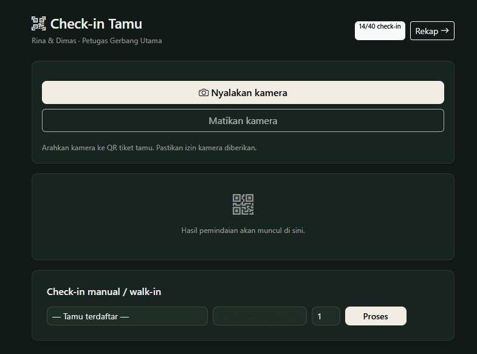

# UndanganKu

Platform undangan digital berbasis Laravel 10 untuk membuat, membagikan, dan mengelola undangan pernikahan, ulang tahun, atau acara lainnya. Tamu cukup membuka satu link personal untuk melihat undangan, mengisi RSVP, menulis ucapan, dan mengunduh tiket QR. Owner memantau semuanya dari dashboard, sementara petugas memakai scanner untuk check-in.

> **Catatan:** file `.env` dan kredensial sensitif tidak disertakan di repository. Gunakan `.env.example` sebagai referensi.

## Tujuan

UndanganKu bertujuan menyediakan satu ruang kerja untuk seluruh proses undangan digital, mulai dari pembuatan undangan, personalisasi link tamu, pengumpulan konfirmasi kehadiran, hingga check-in di lokasi acara. Sistem ini dirancang agar:

- Owner dapat membuat undangan yang terasa personal tanpa perlu menulis kode.
- Tamu mendapat pengalaman membuka undangan yang rapi, responsif, dan mudah dipahami.
- Petugas dapat memverifikasi tamu dengan cepat melalui QR atau check-in manual.
- Admin dapat mengawasi konten, akun, tema, dan aktivitas platform.
- Seluruh data kehadiran dan respons dapat dipantau serta diekspor kapan saja.

## Maksud

Proyek ini dibuat sebagai aplikasi demo sekaligus fondasi sistem undangan digital yang siap dikembangkan lebih lanjut. Maksudnya adalah menggantikan undangan cetak dan penyebaran informasi acara yang terpisah-pisah dengan satu alur terintegrasi:

1. Pemilik acara menyiapkan undangan melalui wizard 9 langkah.
2. Setiap tamu mendapat link unik yang berisi cover personal, detail acara, RSVP, ucapan, amplop digital, dan tiket.
3. Data RSVP dan ucapan langsung masuk ke dashboard owner untuk dipantau dan dimoderasi.
4. Saat acara berlangsung, petugas memindai tiket QR tamu atau melakukan check-in manual/walk-in.
5. Admin menjaga kualitas konten dan keamanan akses lintas peran.

## Fitur yang ada pada sistem

### Untuk tamu

- Tiga tema responsif: **Elegant Gold**, **Rustic Green**, dan **Minimal Modern**.
- Cover personal dengan nama tamu, kutipan, cerita, dress code, dan musik opsional.
- Galeri foto dengan lightbox dan animasi AOS.js.
- Sesi acara lengkap dengan peta Leaflet/OpenStreetMap dan unduhan kalender `.ics`.
- RSVP dengan pilihan hadir/tidak hadir/ragu, jumlah pendamping, dan pertanyaan tambahan.
- Buku tamu/ucapan dengan sanitasi XSS dan moderasi dari owner.
- Amplop digital untuk rekening bank atau e-wallet.
- Tombol bagikan WhatsApp.
- Tiket QR personal dalam format SVG/PDF dengan payload bertanda tangan HMAC.

### Untuk owner

- Wizard 9 langkah: **Info Dasar → Mempelai → Cerita → Acara → Galeri → Musik → RSVP → Amplop & Ucapan → Tamu & Publikasi**.
- CRUD undangan, duplikat, publish/unpublish, preview draft, dan pengaturan kedaluwarsa.
- Manajemen tamu: tambah/edit/hapus, tandai terkirim, impor CSV/XLSX, ekspor Excel/PDF, dan unduh template.
- Upload serta resize foto, atur urutan galeri, upload musik, dan kelola pertanyaan RSVP.
- Statistik tampilan, RSVP, ucapan, dan check-in.
- Balas atau sembunyikan ucapan tamu.
- Buat link petugas dengan token dan PIN 6 digit opsional.

### Untuk petugas

- Login melalui link bertoken dengan PIN opsional.
- Scanner QR berbasis `html5-qrcode` dengan konfirmasi sebelum check-in.
- Check-in manual untuk tamu terdaftar dan walk-in untuk tamu tanpa token.
- Daftar kehadiran serta pencatatan metode check-in: `scan`, `manual`, atau `walk_in`.
- Rekap check-in langsung di halaman scanner.

### Untuk admin

- Statistik global: undangan, tamu, RSVP, ucapan, check-in, dan akun.
- Daftar seluruh undangan dengan aksi takedown.
- Aktif/nonaktifkan akun pengguna dan tema.
- Log aktivitas platform.

### Teknis dan keamanan

- Laravel 10.x, PHP 8.1+, MySQL, Blade, dan Bootstrap 5.
- Autentikasi Laravel Breeze dengan middleware peran `admin`, `owner`, dan `staff`.
- Policy untuk membatasi akses undangan dan data terkait.
- QR tiket hanya berisi identifier, token tamu, versi, dan tanda tangan HMAC.
- Token tamu bersifat personal; RSVP dan ucapan memakai token dari route atau input tersembunyi.
- Lokale `id` dan timezone `Asia/Jakarta`.
- 56 PHPUnit feature test dengan SQLite in-memory.

## Screenshot (Desktop)

### Halaman depan



### Dashboard owner



### Undangan publik



### Scanner petugas



## Demo cepat

Setelah menjalankan seeder, tersedia data berikut:

| Keperluan | Kredensial / tautan |
| --- | --- |
| Admin | `admin@undangan.test` / `password` → `/admin` |
| Owner | `owner@undangan.test` / `password` → `/dashboard` |
| Undangan pernikahan | `/u/rina-dan-dimas` |
| Undangan ulang tahun | `/u/ulang-tahun-dinda` |
| Link tamu personal | `/u/rina-dan-dimas/tamu-001-demo` |
| Tiket tamu | `/tiket/tamu-001-demo/pdf` |
| Petugas dengan PIN | `/petugas/staff-demo-123456` → PIN `123456` |
| Petugas tanpa PIN | `/petugas/staff-demo-cepat` |

Data seeder: 2 user, 2 undangan, 3 sesi acara, 9 foto, 3 amplop, 48 tamu, 45 RSVP, 19 ucapan, 14 check-in, dan 2 link petugas.

## Instalasi singkat

```bash
composer install
cp .env.example .env
php artisan key:generate
```

Buat database MySQL bernama `undanganku`, lalu jalankan:

```bash
php artisan migrate:fresh --seed --force
php artisan storage:link
npm install
npm run build
php artisan serve
```

Aplikasi tersedia di `http://127.0.0.1:8000`. Sesuaikan `APP_URL` dan koneksi database di `.env`.

## Pengujian

```bash
php artisan test --compact
```

## Stack teknologi

| Lapisan | Pilihan |
| --- | --- |
| Backend | Laravel Framework 10.50.x, PHP 8.1+ |
| Database | MySQL, SQLite in-memory untuk test |
| Tampilan | Blade, Bootstrap 5, Bootstrap Icons, CSS tema custom |
| Frontend | Vite, AOS.js, Leaflet, html5-qrcode via CDN |
| QR & PDF | Simple QRCode, DomPDF |
| Spreadsheet & gambar | Maatwebsite Excel, Intervention Image |
| Test | PHPUnit 10.5 |
